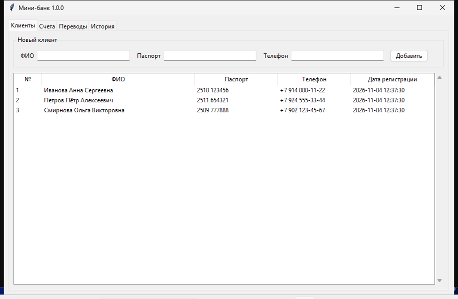
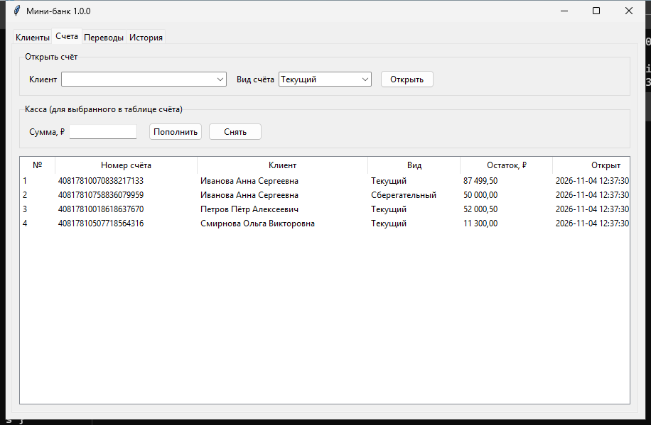
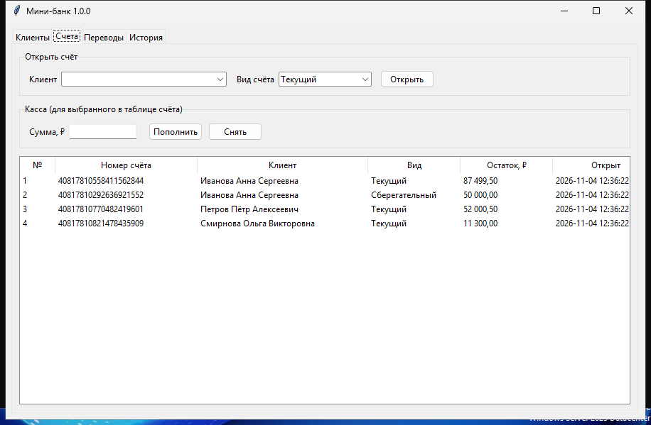
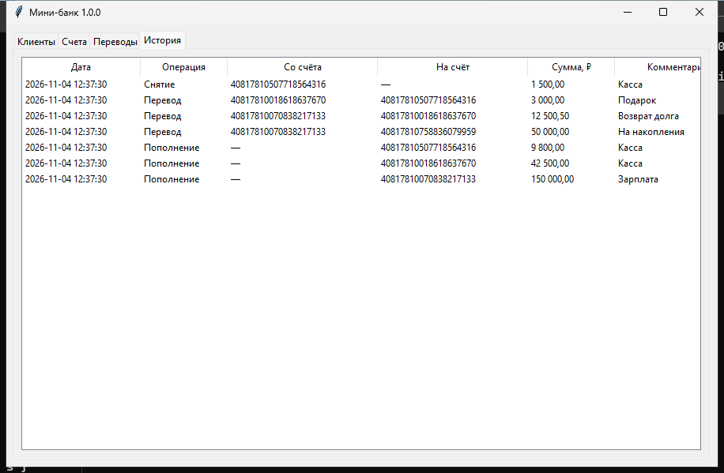
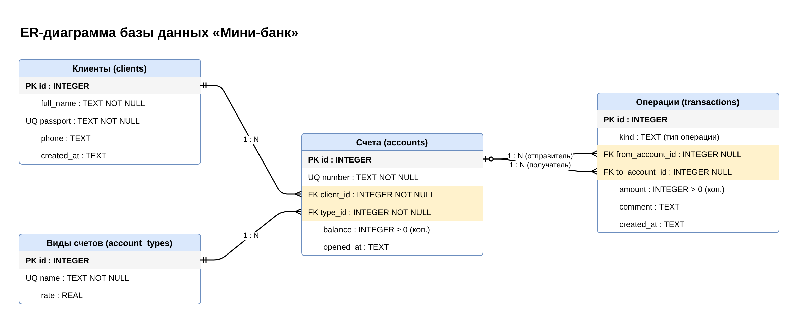

# Мини-банк


Учебный прототип настольной программы для небольшого банка. Ведёт учёт клиентов, их счетов и операций: пополнение, снятие наличных и переводы между счетами. Все операции сохраняются в журнале.

Python 3, интерфейс на Tkinter, база данных SQLite.

## Возможности

- регистрация клиентов (ФИО, паспорт, телефон);
- открытие счетов трёх видов: текущий, сберегательный, кредитный;
- пополнение и снятие через кассу;
- перевод между любыми счетами с проверкой остатка;
- история всех операций.

## Скриншоты

| Клиенты | Счета |
|---|---|
|  |  |
| **Переводы** | **История** |
|  |  |

Скриншоты снимает workflow `screenshots.yml`: он запускает программу на Windows с демо-данными (`tools/seed_demo.py`).

## Установка

Скачайте `MiniBank-Setup-x.y.z.exe` со страницы [Releases](../../releases) и запустите. Установщик создаст ярлык в меню «Пуск» и, по желанию, на рабочем столе. База данных хранится в `%APPDATA%\MiniBank\minibank.db`.

## Запуск из исходников

```
python main.py
```

## Тесты

```
pip install pytest
pytest -v
```

Тесты запускаются автоматически в GitHub Actions при каждом push в ветку `main` (workflow `tests.yml`, Ubuntu и Windows).

## База данных

ER-диаграмма нарисована в draw.io: [`db/er-diagram.drawio`](db/er-diagram.drawio).



По диаграмме написан SQL-скрипт [`minibank/schema.sql`](minibank/schema.sql). Программа выполняет его при первом запуске и так создаёт базу.

## Сборка установщика

Установщик собирается автоматически workflow `release.yml`, когда на GitHub публикуется релиз с тегом версии (например, `v1.0.0`):

```
gh release create v1.0.0 --title "Мини-банк v1.0.0" --notes-file RELEASE_NOTES.md
```

Порядок сборки: тесты, затем PyInstaller делает `MiniBank.exe`, затем Inno Setup упаковывает его в установщик по скрипту [`installer/minibank.iss`](installer/minibank.iss). После этого установщик проверяется тихой установкой и пробным запуском. Готовый `.exe`, ER-диаграмма и SQL-скрипт публикуются в GitHub Releases.

## Структура

```
minibank/       код программы
  bank.py       логика: клиенты, счета, операции
  app.py        окно программы (Tkinter)
  schema.sql    SQL-скрипт создания базы
tests/          тесты pytest
installer/      скрипт Inno Setup
db/             ER-диаграмма (draw.io и PNG)
.github/        workflow для GitHub Actions
```
